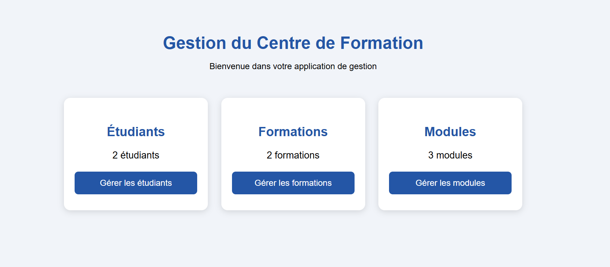
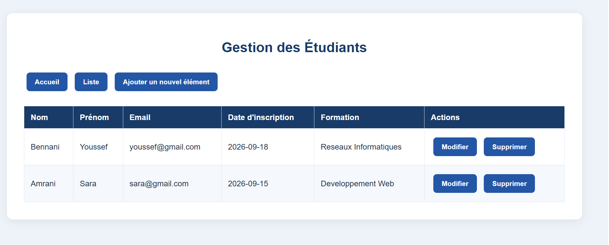
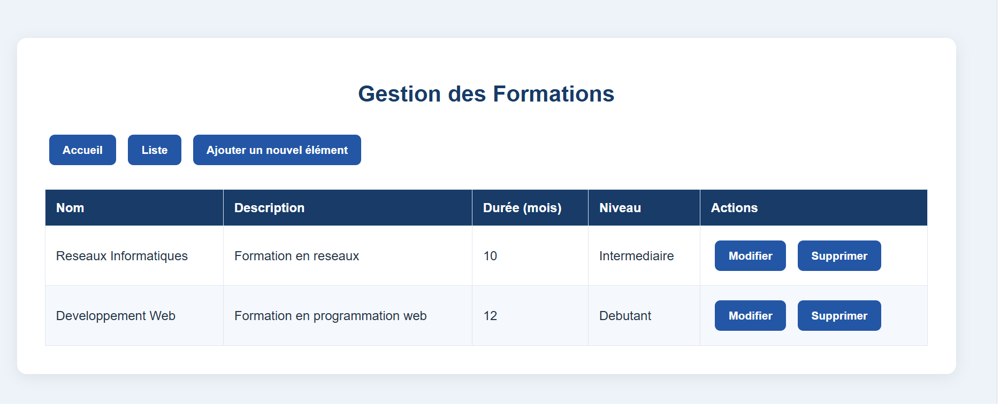
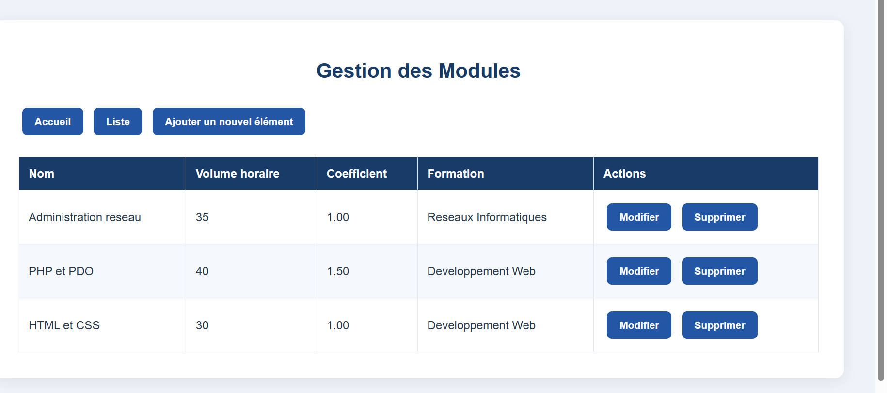

# TP7 – Gestion d'un Centre de Formation

## 1. Présentation du projet

Dans le cadre du TP7, j'ai réalisé une application web de gestion d'un centre de formation.

Cette application permet de gérer les étudiants, les formations et les modules à travers une interface simple et facile à utiliser.

L'objectif de ce TP est de pratiquer PHP, PDO et MySQL et de comprendre comment réaliser les opérations CRUD (Ajouter, Afficher, Modifier et Supprimer).

## 2. Technologies utilisées

- **HTML** : structure des pages.
- **CSS** : design et mise en forme.
- **PHP** : traitement des données.
- **PDO** : connexion à la base de données.
- **MySQL** : stockage des données.
- **phpMyAdmin** : gestion de la base de données.
- **XAMPP** : serveur local.
- **Visual Studio Code** : éditeur de code.
- **Git et GitHub** : gestion et partage du projet.

Cette application permet de gérer les étudiants, les formations et les modules à travers une interface simple.


## 2. Technologies utilisées

- HTML : structure des pages.
- CSS : design et mise en forme.
- PHP : traitement des données.
- PDO : connexion à la base de données.
- MySQL : stockage des données.
- phpMyAdmin : gestion de la base de données.
- XAMPP : serveur local.
- Visual Studio Code : éditeur de code.
- Git et GitHub : gestion du projet.


## 3. Fonctionnalités réalisées

### Gestion des étudiants

- Ajouter un étudiant.
- Afficher la liste des étudiants.
- Modifier les informations d'un étudiant.
- Ajouter un étudiant.
- Afficher la liste des étudiants.
- Modifier les informations.
- Supprimer un étudiant.
- Associer un étudiant à une formation.

### Gestion des formations
- Ajouter une formation.
- Afficher la liste des formations.
- Ajouter une formation.
- Afficher les formations.
- Modifier une formation.
- Supprimer une formation.

### Gestion des modules
- Ajouter un module.
- Afficher la liste des modules.
- Ajouter un module.
- Afficher les modules.
- Modifier un module.
- Supprimer un module.
- Associer un module à une formation.

## 4. Captures d'écran de l'application

### 4.1 Page d'accueil

La page d'accueil contient les trois espaces de gestion : étudiants, formations et modules.



### 4.2 Gestion des étudiants

Cette page permet d'afficher et de gérer les informations des étudiants.



### 4.3 Gestion des formations

Cette page permet de gérer les différentes formations du centre.



### 4.4 Gestion des modules

Cette page permet de gérer les modules associés aux formations.



### 4.5 Formulaire d'ajout

Exemple de formulaire utilisé pour ajouter ou modifier les informations.


## 5. Base de données


**Nom de la base de données :** `tp7_crud`

La base de données contient trois tables principales :
Nom de la base de données : `tp7_crud`

Elle contient trois tables principales :


- `formations`
- `etudiants`
- `modules`

Les tables `etudiants` et `modules` sont liées à la table `formations` grâce à la clé étrangère `id_formation`.

## 6. Organisation du projet

```text
tp7-crud/
│
├── index.php
├── crud.php
├── README.md
│
├── database/
│   └── connexion.php
│
├── includes/
│   └── functions.php
│
├── formations/
│   └── index.php
│
├── etudiants/
│   └── index.php
│
├── modules/
│   └── index.php
│
└── captures/
    ├── accueil.png
    ├── etudiants.png
    ├── formations.png
    ├── modules.png
    └── formulaire.jpeg

```

## 7. lancement du projet

 Ouvrir le navigateur et accéder à l'adresse suivante :

http://localhost/tp7-crud/


**TP7 – PHP, PDO et MySQL**