# TP7 – Application de gestion d'un centre de formation

## 1. Présentation

Dans ce TP, j'ai réalisé une application web permettant de gérer un centre de formation avec PHP, MySQL et PDO.

L'application permet de gérer trois entités : les formations, les étudiants et les modules.

## 2. Diagramme de la base de données

Le diagramme représente les relations entre les trois tables.

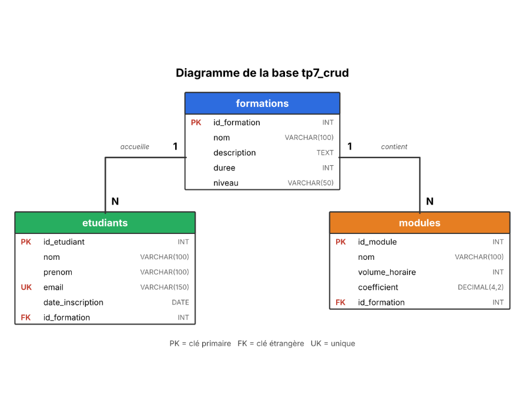

## 3. Création de la base de données

J'ai créé la base de données `tp7_crud` avec phpMyAdmin. Elle contient trois tables :

- `formations`
- `etudiants`
- `modules`

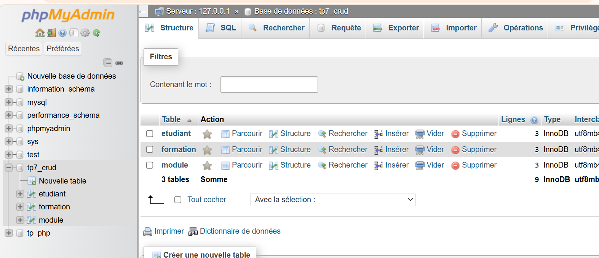

## 4. Réalisation des opérations CRUD

Pour chaque entité, j'ai réalisé les quatre opérations CRUD :

### 4.1 Gestion des etudiants

- **Create :** ajouter un étudiant en choisissant sa formation.
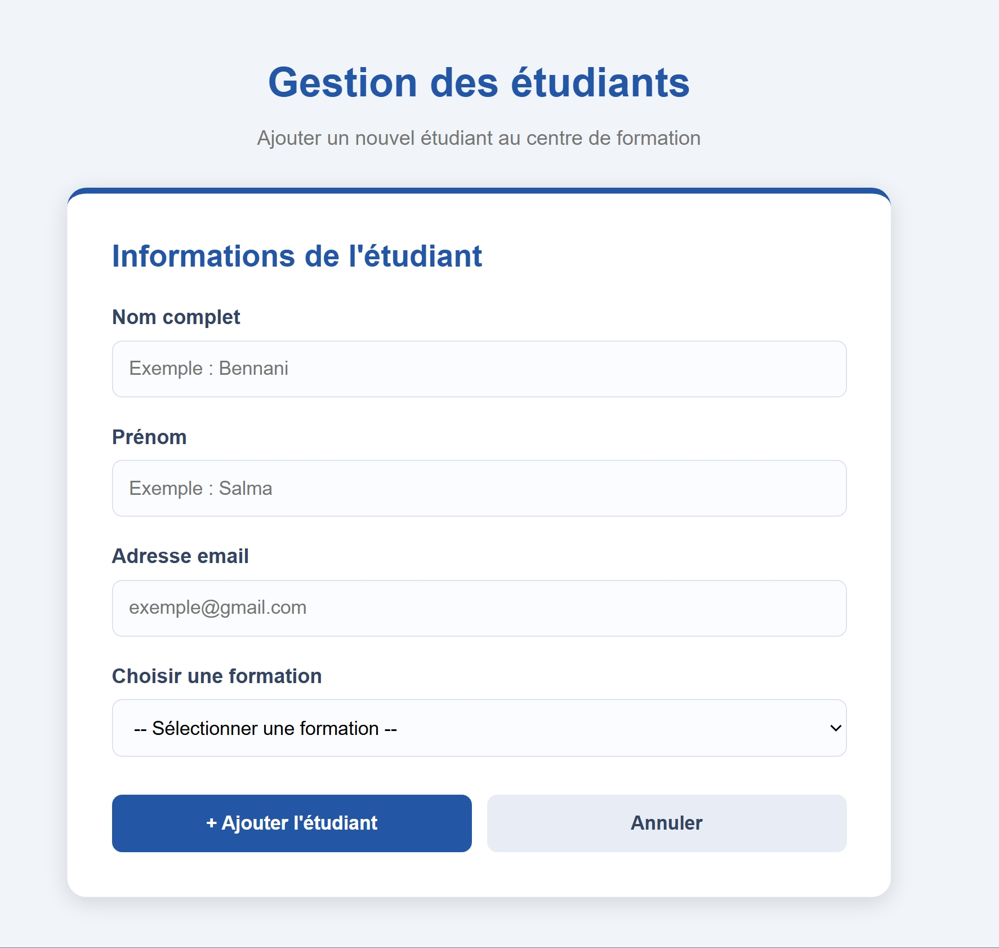
- **Read :** afficher la liste des étudiants avec le nom de leur formation.
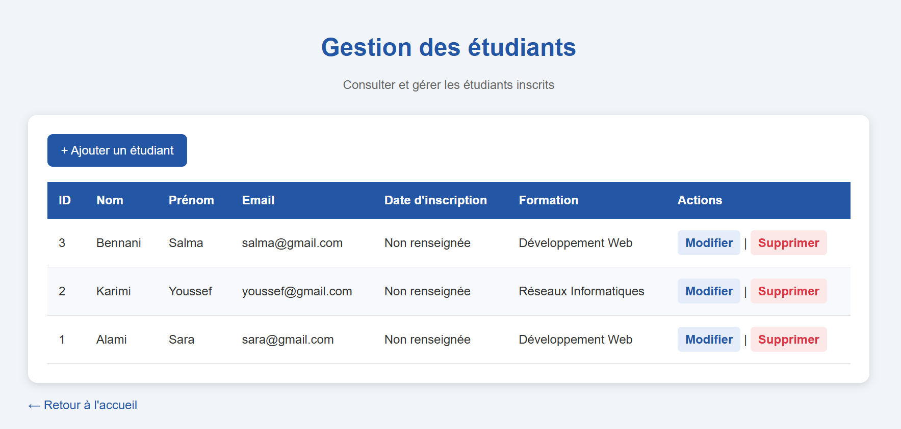
- **Update :**  modifier les informations d'un étudiant.

- **Delete :** supprimer un étudiant.
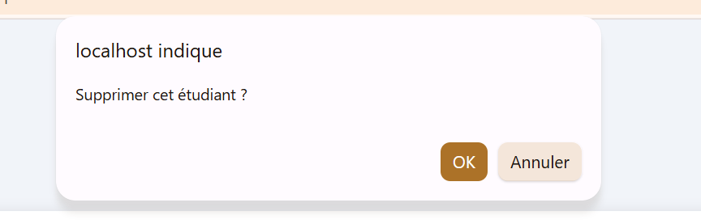
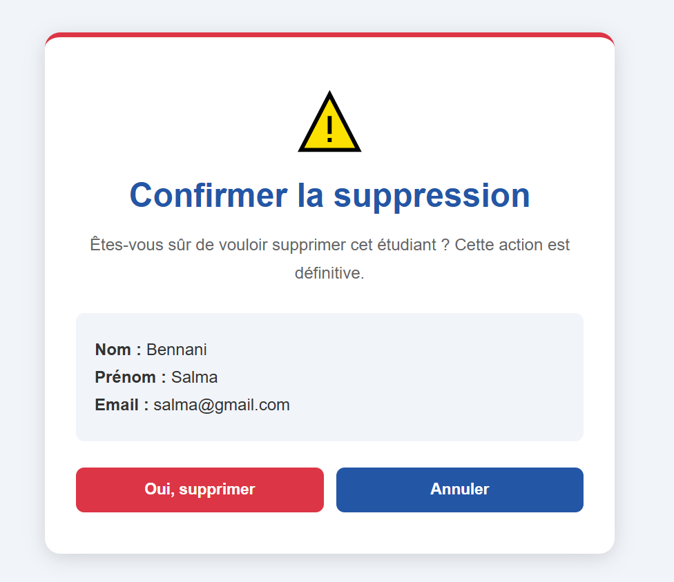
------


### 4.2 Gestion des formation

- **Create :** ajouter une nouvelle formation.
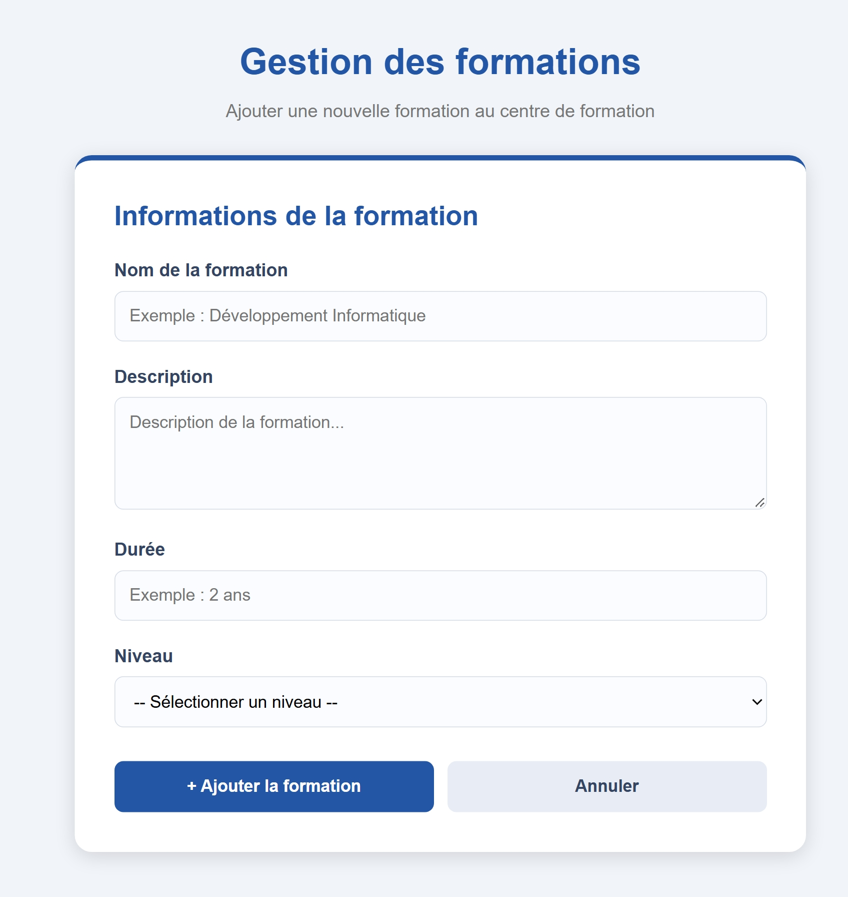
- **Read :** afficher la liste des formations.
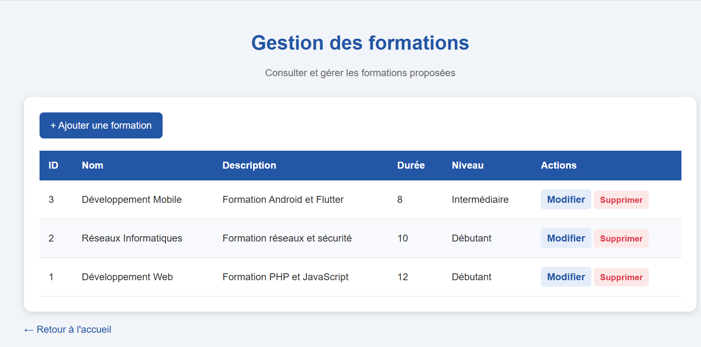
- **Update :**modifier les informations d'une formation.
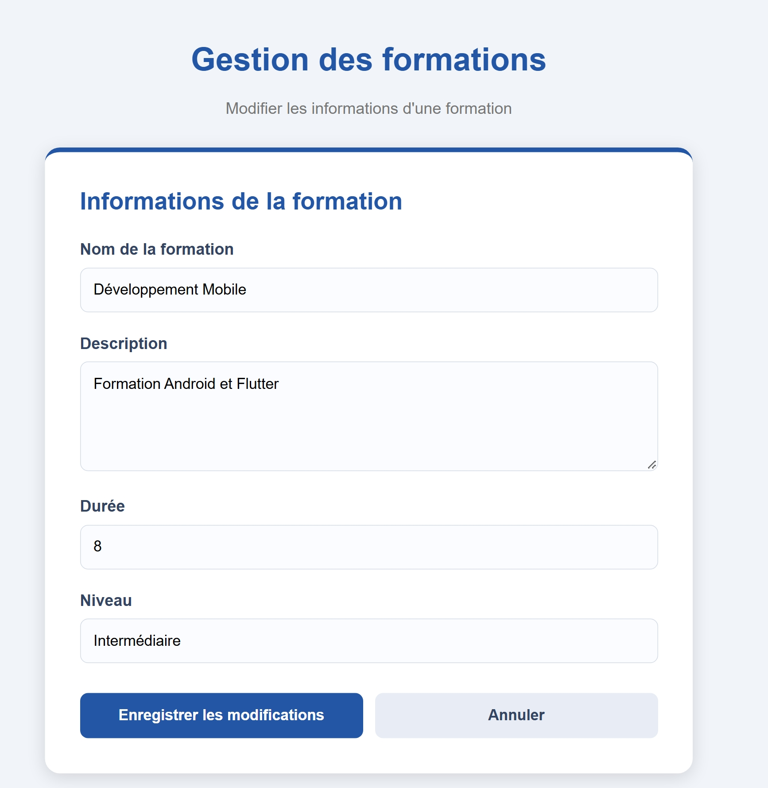
- **Delete :** supprimer une formation.
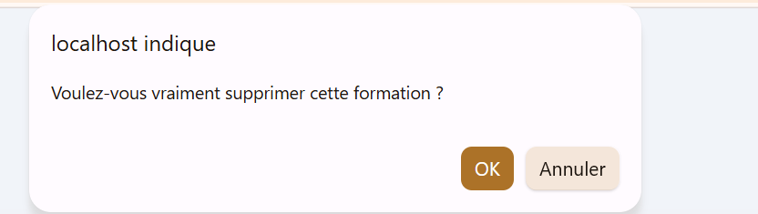
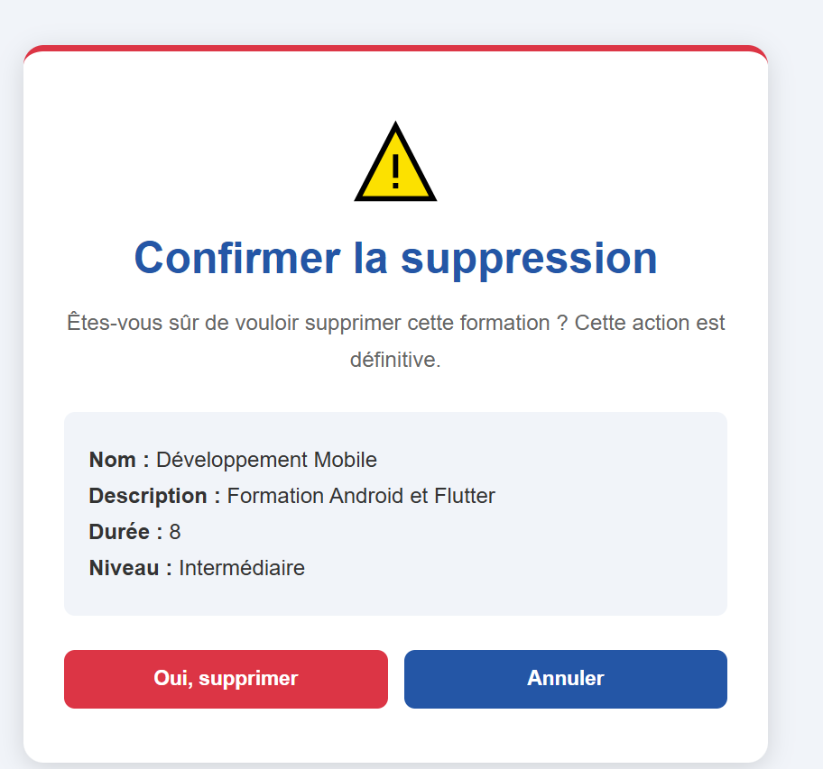
----

### 4.3 Gestion des modules

- **Create :** ajouter un module en choisissant sa formation.

- **Read :** afficher la liste des modules avec le nom de leur formation.
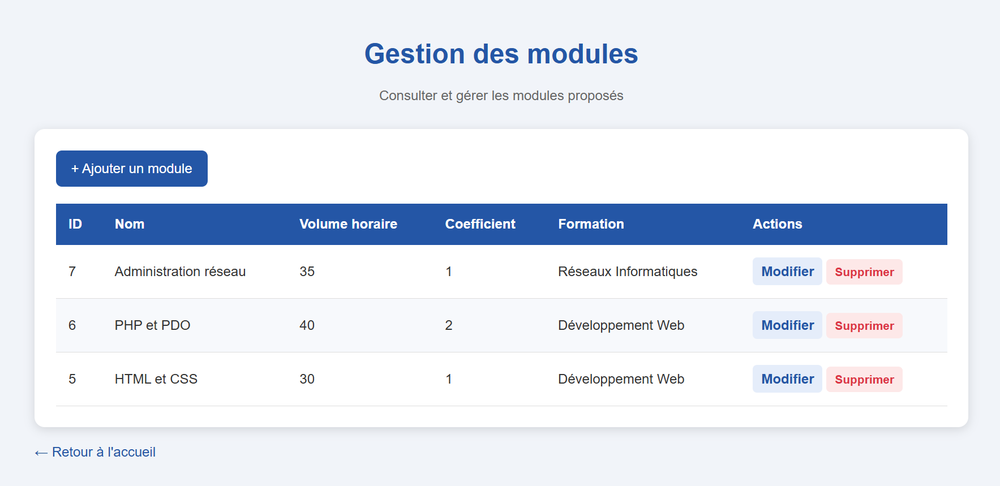
- **Update :** modifier les informations d'un module.
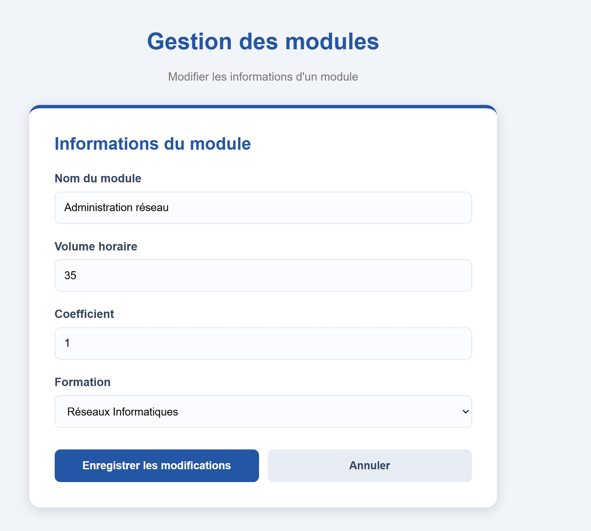
- **Delete :** supprimer un module.
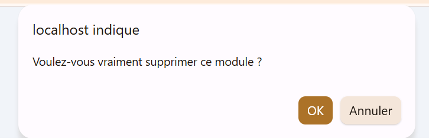
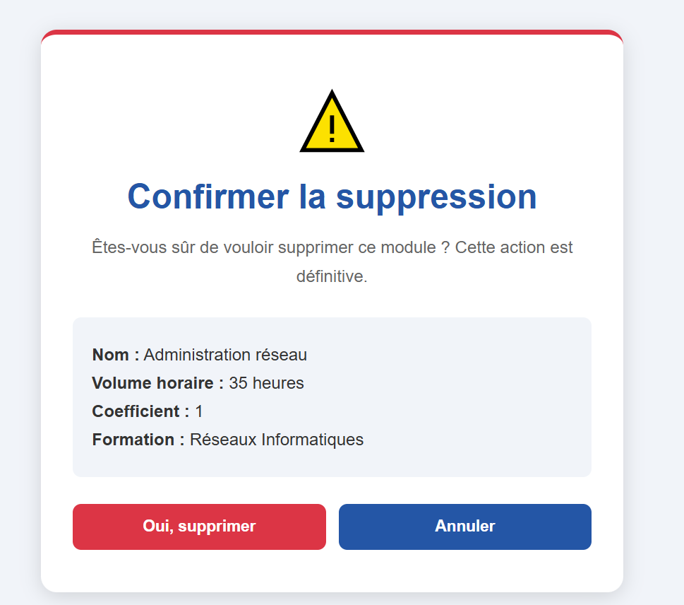
----- 


## 5. Conclusion

Ce TP m'a permis de comprendre comment connecter une application PHP à une base de données MySQL avec PDO et de pratiquer les opérations CRUD. J'ai également appris à utiliser les clés étrangères et les jointures SQL pour relier les formations aux étudiants et aux modules.
## 6. Organisation du projet

```text
tp7-crud/
│
├── index.php
├── README.md
│
├── database/
│   └── connexion.php 
│   └── tp7_crud.sql
│
├── includes/
│   └── functions.php
│
├── formations/
│   └── index.php
│   └── create.php
│   └── edit.php
│   └── delete.php
│
├── etudiants/
│   └── index.php 
│   └── create.php
│   └── edit.php
│   └── delete.php
│
├── modules/
│   └── index.php 
│   └── create.php
│   └── edit.php
│   └── delete.php
│
└── capture/
```

## 7. lancement du projet

 Ouvrir le navigateur et accéder à l'adresse suivante :

http://localhost/tp7-crud/


**TP7 – PHP, PDO et MySQL**